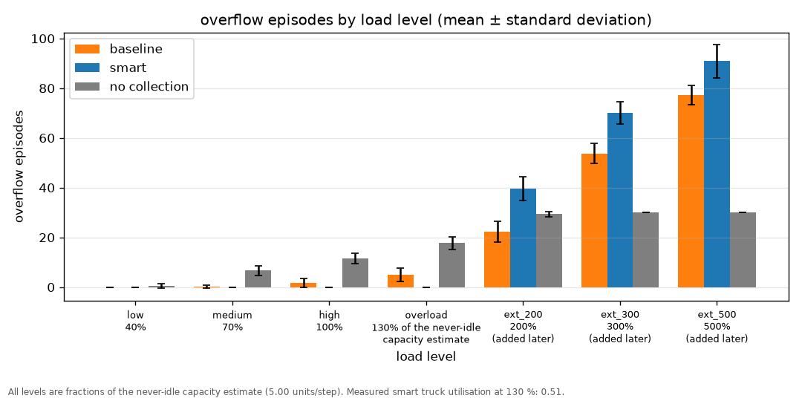
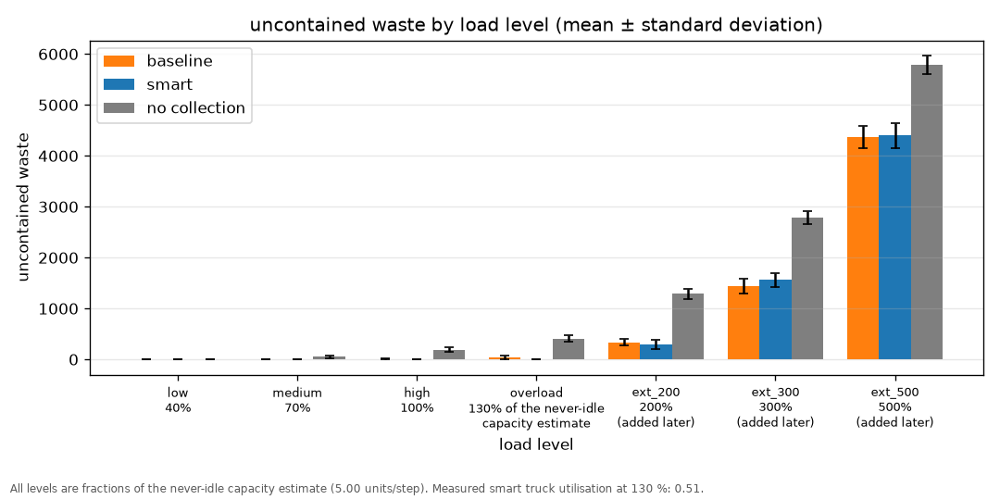
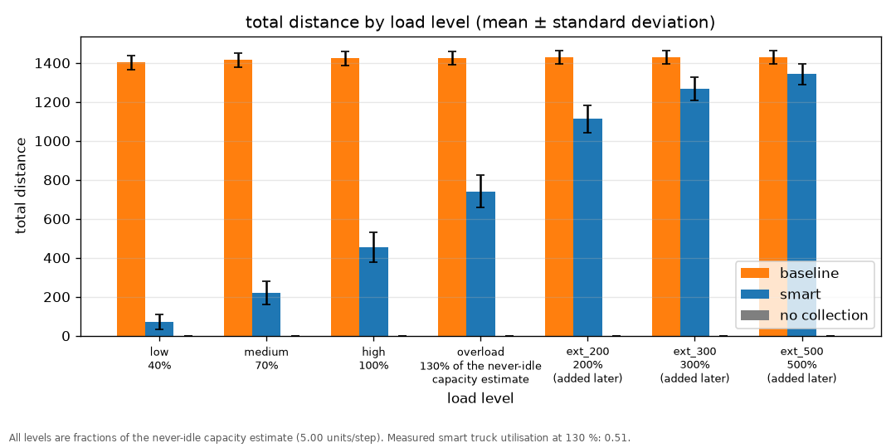
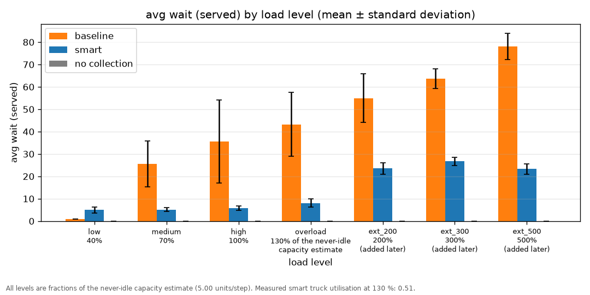
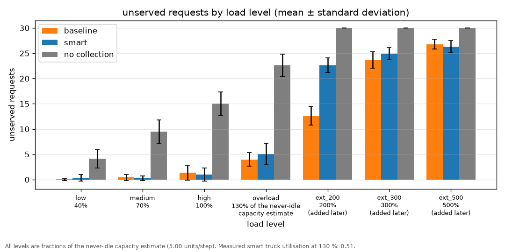
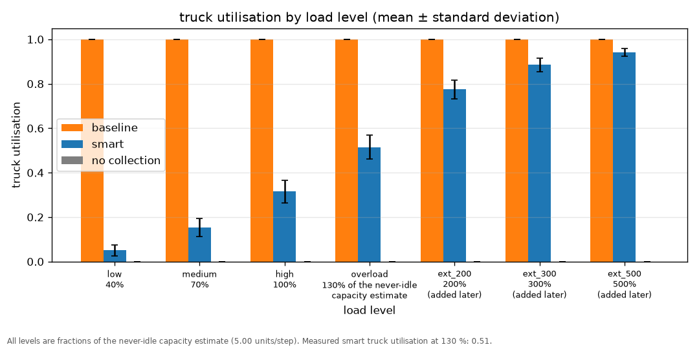
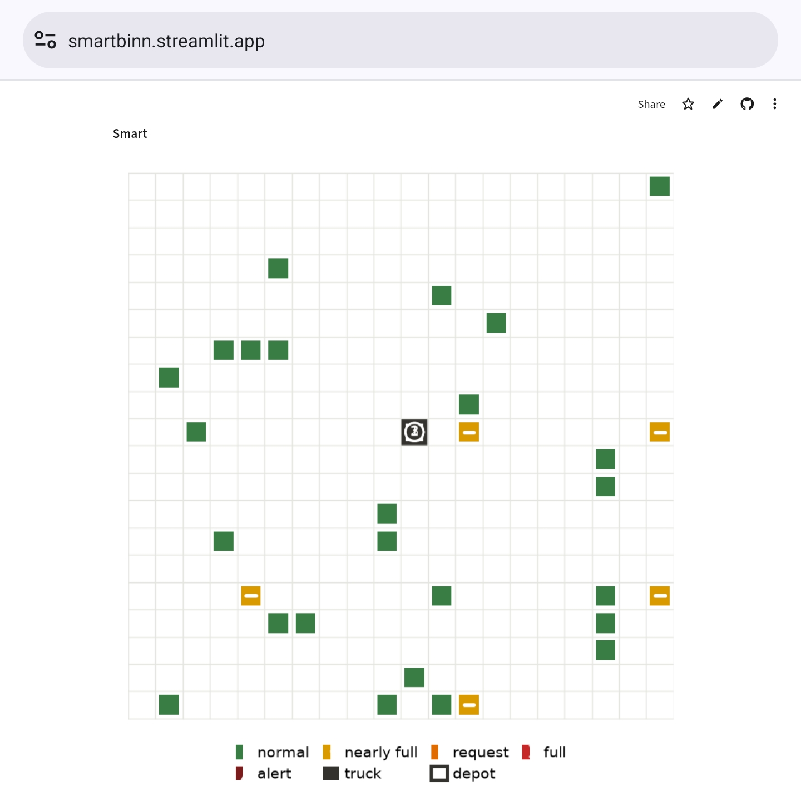
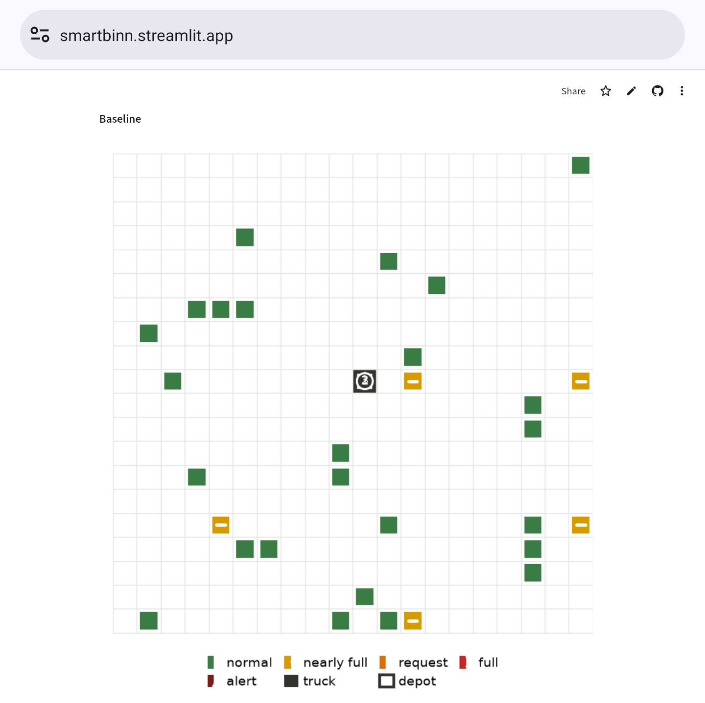
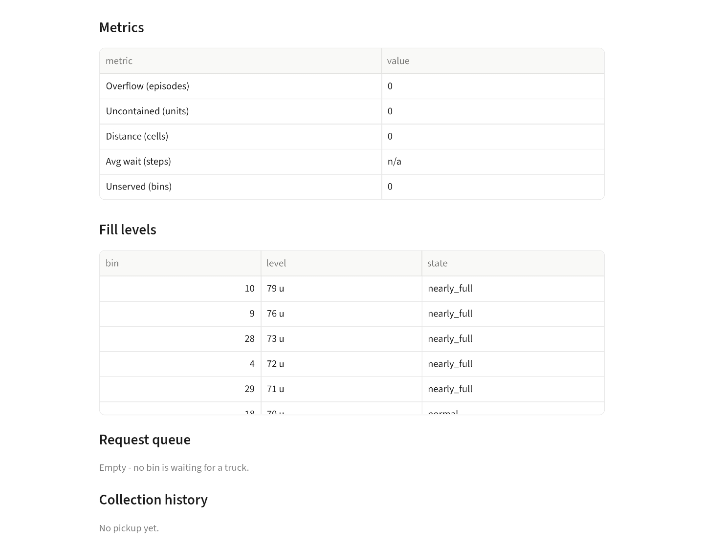
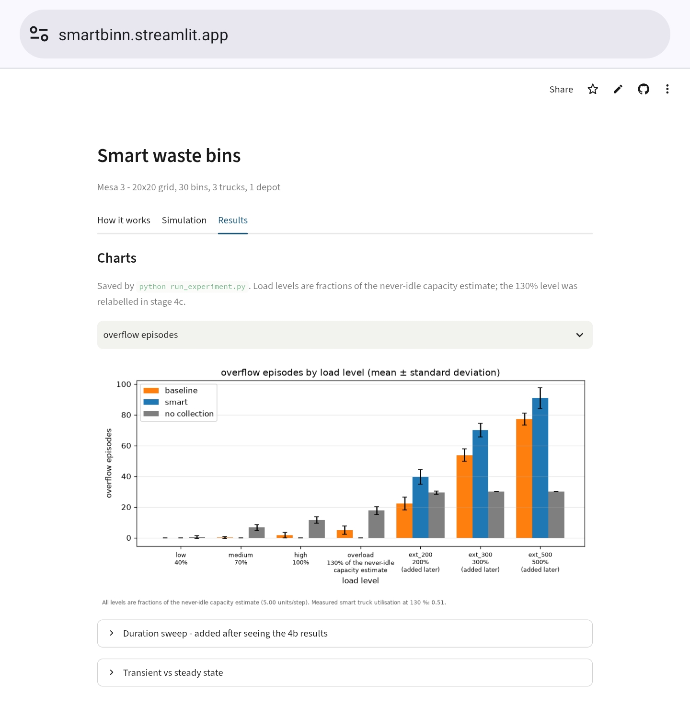

<style>
/* Print styles. Pandoc drops raw HTML when writing .docx, so this only
   affects the HTML -> PDF route. The section 3 diagram is an ASCII box
   drawing, so code blocks need a real monospace face, and the page needs
   wide margins: the longest code line is 92 characters and must not wrap. */
@page { margin: 18mm; }
body { max-width: none; margin: 0; padding: 0; }
pre, code {
  font-family: "DejaVu Sans Mono", "Liberation Mono", monospace;
  font-size: 8pt;
  white-space: pre;
}
pre { border-left: 2px solid #cccccc; padding-left: 8px;
      break-inside: avoid; page-break-inside: avoid; }
table { font-size: 9pt; width: 100%; border-collapse: collapse; }
th, td { padding: 3px 8px; }
figure { break-inside: avoid; page-break-inside: avoid; margin: 12px 0; }
figcaption { font-size: 9pt; color: #444444; }
img { max-width: 100%; }
</style>

# Agent-Based Smart Waste Collection and Route Optimization System

## Abstract

This project builds an agent-based simulation of urban waste collection in Python with Mesa 3 and tests dispatch optimization against a fixed-route baseline: which bin is served, by which truck, and in what order. Thirty bins, three trucks and one central depot fill and empty over repeated days at seven load levels. Staged checks on single agents, and two identities asserted on every run, verify the behaviour; one is a mass balance proving no waste is lost or created. Over one day at 40 to 130 percent of a never-idle capacity estimate, the dispatcher produces no overflow, drives about half as far as the fixed route and cuts waiting fivefold. Over six days at 130 percent it overflows more often. A live dashboard steps through both strategies side by side.

## 1. Introduction

Waste bins fill at different rates depending on where they stand, and collection vehicles have limited capacity and limited time. Scheduling the two against each other is the problem this project addresses: deciding which bin to empty next, and which vehicle should do it.

The objective is to build a simulation in which the effect of that decision can be measured rather than argued about. The system contains 30 waste bins on a 20 by 20 grid, three collection trucks and one depot. Two strategies are compared on exactly the same waste, in exactly the same order, over the same days: a baseline in which each truck follows a fixed round through the city and empties whatever it finds, and a smart strategy in which a central dispatcher sends the nearest free truck to whichever bin needs emptying most. The project asks which strategy wastes less, which serves people faster, and under what conditions each one fails.

### Scope of route optimization

The optimization tested here is **dispatch optimization**, not route optimization in the vehicle-routing sense. The dispatcher decides three things: which bin is served, which truck serves it, and in what order the queue is worked - fullest bin first, nearest free truck first. That decision is compared against the fixed-route baseline on three measures: total distance driven, waiting time before a bin is emptied, and overflow when a bin reaches 100 percent.

No multi-stop route planning is performed. The smart strategy averages **1.00 bins per trip** at the reference load, against **1.07 ± 0.05** for the baseline, because a truck holds 20 units and a bin at the 90 unit collection threshold offers exactly one full load. One visit fills the truck, so there is never a choice between chaining several bins into one trip and going straight to the depot. The savings this report measures come from not driving at all when no bin needs emptying, not from sequencing a tour more cleverly. Multi-stop routing with larger trucks, where a single trip could serve several bins in an order chosen for distance, is future work and is listed as such in the conclusion.

## 2. Background

An **agent** is a software object that represents one thing in a system and decides what to do next from a small set of rules. An agent observes part of its surroundings, applies rules, and acts. Agents do not share a central program that decides everything; the behaviour of the whole system emerges from the agents interacting.

A **multi-agent system** is a collection of agents in a shared environment. Each agent has its own state and its own view. There is no global controller that computes the answer and hands it down. In this project the agents are bins, trucks and a dispatcher; they share a city grid and a queue of work.

The agents are **rule-based**. Every decision is a written rule over numbers: a bin asks for a collection when it crosses 90 units, a truck takes what fits, the dispatcher picks the fullest bin and sends the nearest free truck. No machine learning is used anywhere. This matters for the results. When a number in this report moves, it moves because a rule changed, and the rule can be read in the source.

## 3. System design

Three agent types interact. Each observes, decides and acts differently.

**Bin.** A bin observes the waste arriving into it each step and its own temperature. It decides when to ask for a collection, when to raise a safety alert, and when it has been emptied enough for the request to close. It holds one open request at a time and never raises a duplicate.

**Collector (truck).** A truck observes its own position, how full it is, and which bin it was sent to. It decides whether to drive on, to stop and load, or to return to the depot and unload. It carries 20 units and takes only what fits, so a bin holding more than the truck can carry is partly emptied and keeps the rest.

**Dispatcher.** The dispatcher observes which bins have an open request, which of those are safe to touch, and where the free trucks are. It decides which truck should go to which bin. It works fullest bin first, and among equally full bins the lower bin id goes first; among equally distant trucks the lower truck id goes first, so the same scenario always produces the same run.

```
+--------------------------+
| SCENARIO                 |
| waste per bin per step,  |
| temperature per bin      |
+--------------------------+
              |
              |  read only, never written to
              v
+--------------------------+
| CITY MODEL               |
| waste -> temperature ->  |
| assign -> trucks move    |
+--------------------------+
              v                                v
+--------------------------+     +--------------------------+
| BIN  (30)                |     | DISPATCHER  (1)          |
| sees: waste in,          | --> | sees: which bins         |
| temperature              |     | ask, where the free      |
| decides: when to         | <-- | trucks are               |
| ask, when to alert       |     | decides: truck, bin      |
+--------------------------+     +--------------------------+
              |                                |
              |                               | jobs
              v                                v
              | collection
              v
+--------------------------+
| COLLECTOR  (3 trucks)    |
| sees: position, load,    |
| assigned bin             |
| decides: drive on, load, |
| or go back to the depot  |
+--------------------------+
                         | full truck
              v
+--------------------------+
| DEPOT (1)                |
| unload and carry on      |
+--------------------------+
```

Two safety rules apply to both strategies. A bin whose temperature rises above 45 degrees raises an alert, and no truck will empty a bin while that alert is on. The alert is a state of its own, separate from the collection request, and it clears itself five steps after it was raised. A truck that is sent to a bin releases the job if the bin raises an alert, or if the bin is emptied by somebody else before the truck arrives, rather than driving on for a pickup that would collect nothing.

## 4. Implementation

The system is written in Python and uses Mesa 3 for the agent base classes and the model container. It uses no scheduler: the model walks its own agent list in a fixed order each step. Streamlit renders the dashboard.

| File | Contents |
| --- | --- |
| `config.py` | Every tunable number, plus the load calibration |
| `scenario.py` | Pre-generated, replayable scenarios built from a seed |
| `agents.py` | `BinAgent`, `CollectorAgent`, `DispatcherAgent` |
| `model.py` | `CityModel` and the three strategies, plus the metrics |
| `demo.py` | The staged behaviour checks |
| `run_experiment.py` | The experiment, the tables and the charts |
| `test_dashboard.py` | Proves the dashboard reproduces the experiment |
| `app.py` | The Streamlit dashboard |

The city is a 20 by 20 grid holding 30 bins, 3 trucks and 1 depot at cell (10, 10). A bin holds 100 units. The thresholds are fixed: below 70 units a bin is normal, from 70 it is nearly full, and at 90 units it asks for a collection. One request per bin is allowed at a time.

A truck carries 20 units and covers 2 cells per step. Pickup is partial by design: the truck takes `min(its free space, the bin contents)` and leaves the rest. If the bin stays at or above 90 units afterwards, the request stays open and the bin is queued again on the next step. When the truck reaches its capacity it returns to the depot, unloads, and resumes.

**The safety-team assumption.** A temperature above 45 degrees raises a safety alert that stops any truck emptying that bin, and the alert clears itself after five steps. This models a safety team that must make the bin safe before a truck can approach it. The same rule applies to both strategies, so it does not bias the comparison.

## 5. Experiment setup

**Two strategies, identical inputs.** The baseline cuts the 30 bins into one route per truck by a deterministic rule: the compass around the depot is divided into three equal wedges, each bin falls into the wedge its direction points at, and the bins inside a wedge are visited in nearest-neighbour order starting from the depot. No random numbers are involved. A free baseline truck takes the next bin on its list and empties whatever it finds, including from bins that never asked. The smart strategy uses the dispatcher described above.

Both strategies replay the same pre-generated scenarios. A scenario fixes the bin positions, the starting fill levels, the waste arriving in each bin at each step, and the temperature of each bin at each step. It is generated once from a seed and then only read. `demo.py 4` checks this by comparing the scenario object against a freshly generated one from the same seed after both strategies have run. No strategy calls the random generator during a run.

**Load levels.** The scenarios produce a nominal amount of waste, and a multiplier applied while the model reads the arrivals sets how busy the city is. Both strategies therefore face the same waste at the same step. The load levels are expressed as fractions of a never-idle capacity estimate, which is what a fleet could collect if every truck spent every step on a full pickup:

```
typical bin distance d  = average grid distance from the depot to a cell  = 10.0 cells
round trip steps        = 2 * d / TRUCK_SPEED + 2                       = 12 steps
never-idle capacity     = N_COLLECTORS * TRUCK_CAPACITY / round trip    = 3 * 20 / 12
                                                                            = 5.0 units/step
```

The two extra steps are loading a bin and unloading at the depot. The city arrival rate is measured from the generated scenarios rather than assumed, because arrivals are clipped at zero, which pushes the average above the nominal rate.

| Level | Fraction | Waste per step | Load scale | |
| --- | --- | --- | --- | --- |
| low | 40 % | 2.0 units/step | 0.135 | original sweep |
| medium | 70 % | 3.5 units/step | 0.236 | original sweep |
| high | 100 % | 5.0 units/step | 0.337 | original sweep |
| overload | 130 % | 6.5 units/step | 0.438 | original sweep, the reference load |
| ext_200 | 200 % | 10.0 units/step | 0.674 | added after seeing the first sweep |
| ext_300 | 300 % | 15.0 units/step | 1.010 | added after seeing the first sweep |
| ext_500 | 500 % | 25.0 units/step | 1.684 | added after seeing the first sweep |

The reference load is chosen by a rule fixed before the smart strategy was ever run: a run counts as saturated when more than 20 percent of the bins are still unserved at the end of the day, and the reference load is the highest level whose average over all scenarios stays at or below that share. The rule is applied to the baseline only. It selects `overload`. The three `ext_` levels were added afterwards, when the four original levels turned out never to saturate the baseline; they are used only to find out where each strategy breaks, and they take no part in the calibration.

**Runs.** 20 scenarios are generated from seeds 1000 to 1019. Each scenario is run at all seven load levels under all three strategies, where the third is a no-collection lower bound in which the trucks never move. That is 420 runs. A second sweep repeats the four original load levels at one, three and six times the length of a day, giving 480 further runs.

**Metrics.** Overflow episodes count once, on the step where a bin first reaches 100 percent, and again only after a collection has emptied it. Uncontained waste is the total that no longer fitted into a full bin. Total distance is cells driven by all trucks. Average wait is measured from the moment a bin crosses the collection threshold to the pickup that closes the request, over the requests that were actually served; the number of requests still unserved at the end is reported separately. Bins per trip is the mean number of bins emptied per finished trip. Truck utilisation is the share of the day each truck was not idle, averaged over the trucks. Mean queue length is the average number of bins waiting for a truck, measured every step for every strategy.

**Two identities are asserted on every run.** First, `requests_raised == completed_pickups + unserved_requests`, so no request is lost or counted twice. Second, the mass balance:

```
offered == collected + uncontained + (bin contents at the end - at the start)
```

Nothing may be lost and nothing may appear. The tolerance is 0.25 units, which covers the two decimals the bin levels are stored with. The largest gap seen across all 420 runs is 0.05 units.

## 6. Results

### 6.1 The reference load

At `overload`, 130 percent of the never-idle capacity estimate, mean and standard deviation over 20 scenarios:

| Metric | Baseline | Smart | No collection |
| --- | --- | --- | --- |
| Overflow episodes | 5.05 ± 2.72 | **0.00 ± 0.00** | 17.70 ± 2.60 |
| Uncontained waste (units) | 38.55 ± 29.32 | **0.00 ± 0.00** | 411.91 ± 66.30 |
| Total distance (cells) | 1,426.45 ± 34.28 | **740.45 ± 83.87** | 0.00 |
| Average wait, served (steps) | 43.23 ± 14.25 | **8.07 ± 1.76** | n/a |
| Unserved requests at the end | **4.00 ± 1.38** | 5.05 ± 2.14 | 22.60 ± 2.19 |
| Bins per trip | **1.07 ± 0.05** | 1.00 ± 0.00 | n/a |
| Truck utilisation | 1.00 ± 0.00 | 0.51 ± 0.05 | 0.00 |
| Mean queue length | 1.58 ± 0.70 | **0.52 ± 0.27** | 9.17 ± 1.16 |
| Maximum wait, served (steps) | 93.45 ± 31.53 | **22.80 ± 7.16** | 0.00 |
| Maximum wait, still open (steps) | 76.45 ± 35.82 | **16.85 ± 9.22** | 246.10 ± 15.26 |
| Bins at 100 % at the end | 1.85 ± 1.53 | **0.00 ± 0.00** | 17.70 ± 2.60 |
| Units collected | 1,455.53 ± 106.64 | 761.00 ± 84.72 | 0.00 |
| Units collected per step | 4.85 ± 0.36 | 2.54 ± 0.28 | 0.00 |

The dispatcher produces no overflow and no uncontained waste at this load, while the baseline produces 5.05 overflow episodes and 38.55 units on the street. The dispatcher drives 740.45 cells against the baseline's 1,426.45, and cuts the average wait from 43.23 steps to 8.07. It is busy 0.51 of the day; the baseline is busy 1.00.

The baseline wins on unserved requests and on bins per trip, and both of those need the caveat in section 7.

**Throughput check.** The never-idle estimate predicts 5.00 units per step. Measured at the reference load:

| Measured | Value | Against the estimate |
| --- | --- | --- |
| Baseline, whole day | 4.85 units/step | 97 % |
| Smart, whole day | 2.54 units/step | 51 % |
| Smart, best 12-step burst | 7.25 units/step | 145 % |
| Busiest single step | 36 units | not comparable |

The estimate describes the baseline almost exactly, because the baseline is the strategy that never idles. It overstates the dispatcher by 49 percent, because the dispatcher deliberately waits until a bin crosses 90 units. The estimate is a capacity figure, not a prediction of what the dispatcher collects.

### 6.2 The load sweep

Baseline and smart, mean over 20 scenarios, one day of 300 steps:

| Load | Metric | Baseline | Smart |
| --- | --- | --- | --- |
| low, 40 % | overflow episodes | 0.00 | 0.00 |
| | uncontained waste | 0.00 | 0.00 |
| | total distance | 1,401.75 | 71.90 |
| | average wait, served | 1.00 * | 4.97 |
| | unserved requests | **0.05** | 0.35 |
| | bins per trip | **1.43** | 1.00 |
| | truck utilisation | 1.00 | 0.05 |
| medium, 70 % | overflow episodes | 0.20 | **0.00** |
| | uncontained waste | 0.65 | **0.00** |
| | total distance | 1,414.50 | **218.70** |
| | average wait, served | 25.69 | **5.16** |
| | unserved requests | 0.40 | **0.25** |
| | bins per trip | **1.24** | 1.00 |
| | truck utilisation | 1.00 | 0.15 |
| high, 100 % | overflow episodes | 1.70 | **0.00** |
| | uncontained waste | 7.48 | **0.00** |
| | total distance | 1,423.25 | **453.65** |
| | average wait, served | 35.65 | **5.77** |
| | unserved requests | 1.40 | **1.00** |
| | bins per trip | **1.13** | 1.00 |
| | truck utilisation | 1.00 | 0.32 |
| overload, 130 % | overflow episodes | 5.05 | **0.00** |
| | uncontained waste | 38.55 | **0.00** |
| | total distance | 1,426.45 | **740.45** |
| | average wait, served | 43.23 | **8.07** |
| | unserved requests | **4.00** | 5.05 |
| | bins per trip | **1.07** | 1.00 |
| | truck utilisation | 1.00 | 0.51 |

\* The baseline's average wait at 40 percent load rests on a single scenario out of 20 that served any request at all, so that cell is not a meaningful average and is excluded from the discussion.

The baseline drives 1,401.75 to 1,426.45 cells at every load level, because it drives its full route whatever happens. The dispatcher drives between 71.90 and 740.45 cells, rising with the waste, because it only leaves the depot when a bin is worth the trip.

{#fig:overflow}

{#fig:uncontained}

{#fig:distance}

{#fig:wait}

{#fig:unserved}

{#fig:utilisation}

**Where each strategy breaks.** Both strategies first pass 20 percent unserved at `ext_200`, 200 percent of the never-idle estimate. The smart strategy first shows any overflow at the same level, where it averages 39.65 overflow episodes against the baseline's 22.30. At `ext_500` the two have converged: 90.85 overflow episodes for the dispatcher against 77.25 for the baseline, with no-collection at 30.00. When nothing can keep up, the dispatching policy stops mattering.

**No starvation of distant bins.** A bin of this city sits 10.0 cells from the depot on average. At the reference load, the bins still waiting under the baseline sit 10.81 cells away and those still waiting under the dispatcher sit 9.77 cells away. The dispatcher does not leave the outskirts behind.

### 6.3 The duration sweep

The four original load levels were re-run at one, three and six times the length of a day, 20 scenarios each. At `overload`:

| Length | Strategy | Overflow episodes | Uncontained waste | Unserved requests | Queue length | Net bin fill change |
| --- | --- | --- | --- | --- | --- | --- |
| 1x, 300 steps | baseline | 5.05 ± 2.72 | 38.55 ± 29.32 | 4.00 ± 1.38 | 1.58 ± 0.70 | +455.91 ± 113.34 |
| 1x, 300 steps | smart | **0.00 ± 0.00** | **0.00 ± 0.00** | 5.05 ± 2.14 | 0.52 ± 0.27 | +1,188.99 ± 99.49 |
| 3x, 900 steps | baseline | **56.05 ± 11.19** | **667.06 ± 220.66** | **12.20 ± 2.57** | 6.11 ± 1.31 | +936.65 ± 256.30 |
| 3x, 900 steps | smart | 118.10 ± 15.18 | 702.54 ± 246.20 | 18.85 ± 1.42 | 10.10 ± 1.17 | +1,480.16 ± 102.16 |
| 6x, 1800 steps | baseline | **185.10 ± 34.77** | 2,261.57 ± 567.74 | **15.05 ± 2.84** | 9.99 ± 1.59 | +1,079.15 ± 259.83 |
| 6x, 1800 steps | smart | 335.75 ± 16.58 | **2,170.79 ± 601.78** | 18.65 ± 1.69 | 13.64 ± 0.99 | +1,482.30 ± 101.01 |

**The dispatcher's zero overflow at 130 percent does not survive.** At one day, none of the 20 scenarios spills. At three days, all 20 spill, with 118.10 overflow episodes on average. At six days the dispatcher records 335.75 overflow episodes against the baseline's 185.10. The same pattern appears one level lower. At 100 percent the dispatcher is clean after one day, 0.00 overflow episodes against the baseline's 1.70. After three days it averages 8.55 overflow episodes against the baseline's 19.25, and 7 of its 20 scenarios have already spilled. After six days it averages 90.00 against the baseline's 80.45. At 70 percent and below the dispatcher records zero overflow at every duration that was run.

**Truck utilisation over the longer runs**, smart strategy:

| Load | 1x (300 steps) | 3x (900 steps) | 6x (1800 steps) |
| --- | --- | --- | --- |
| low, 40 % | 0.05 | 0.16 | 0.28 |
| medium, 70 % | 0.15 | 0.46 | 0.60 |
| high, 100 % | 0.32 | 0.73 | 0.86 |
| overload, 130 % | 0.51 | 0.84 | 0.92 |

Utilisation climbs with duration at every load level. At 130 percent the dispatcher is busy 0.51 of the first day, 0.84 by the third and 0.92 by the sixth. The clean one-day result is partly a fleet that has not yet come under pressure.

## 7. Discussion

**Why the dispatcher wins on short runs and at low or medium load.** It spends effort only where it is needed. At the reference load the baseline makes 78 pickups but only 7 of them answer a request; the rest are taken from bins nobody asked about. The dispatcher's 38 pickups all answer a request. The dispatcher also keeps waiting low, at 8.07 steps against 43.23, because it never drives to a bin that is not ready. The saving shows up directly in distance: 740.45 cells against 1,426.45.

**Why it overflows more under sustained high load.** This is a likely explanation, not a proven one. The dispatcher only serves bins at or above 90 units. Once a bin is emptied to below 90 it is ignored until it refills, so the threshold effectively divides each bin's attention between the dispatcher and nobody. When every bin is above 90 for long stretches, that rule can no longer choose between a bin that is urgent and one that is not; it can only order bins that are all equally urgent, and it does so by fullness. Effort then spreads thinly across bins that are all spilling rather than rotating evenly over them. Two measurements are consistent with this reading: at three days the dispatcher finishes with a larger backlog than the baseline, +1,480.16 against +936.65 units of net bin fill change, and it leaves more bins unserved, 18.85 against 12.20. The proposed test is in section 9.

**Why the baseline wins on unserved requests, and why that metric flatters it.** Unserved requests counts only bins that are still at or above the collection threshold. The baseline empties bins that never asked, which pushes them below the threshold, so they are not counted as unserved at the end of the day. The baseline therefore looks better on this number while causing more uncontained waste in the same runs, 38.55 units against 0.00. Overflow episodes and uncontained waste are the fairer pair, and on both of those the dispatcher wins at this load. The baseline's win on unserved requests is better read as a sign that it clears the whole city indiscriminately rather than as a sign that it serves urgent demand better.

**Why the baseline wins on bins per trip.** With a 20-unit truck and a 90-unit threshold, one bin is enough to fill a truck, so a dispatcher truck that only visits requesting bins almost always collects exactly one bin per trip and sits at 1.00. The baseline also visits bins holding less than a full load and chains several of them into one trip, giving 1.07 at the reference load and 1.43 at low load. This is a structural consequence of the capacity-to-threshold ratio rather than a sign of better scheduling.

**One-day results and steady state.** The bins do not start empty: they start between 10 and 80 units, so the city opens each day already holding waste. That opening balance absorbs arrivals before anything can spill, which is why a one-day run flatters both strategies. The dispatcher finishes the reference-load day 1,188.99 units above where it started and the baseline 455.91 units above. Neither is in a steady state. One day answers "what does a normal day look like"; the longer runs answer "which strategy keeps up when the backlog is real".

## 8. Assumptions and limitations

* **Depot position.** One depot sits at cell (10, 10), in the middle of the city. An average bin is 10.0 cells away. The distance figures depend on that choice.
* **Truck speed and paths.** Trucks cover 2 cells per step and drive Manhattan shortest paths on an empty grid. Obstacles, one-way streets or congestion would change every distance number.
* **The baseline is deliberately naive.** It walks a fixed route and empties whatever it finds, including bins that never asked. This is a fair comparison against no dispatching at all, but it is not the strongest possible fixed schedule. A tuned-frequency baseline that visited busy bins more often and quiet corners less often would waste fewer trips without any dispatcher, and would probably narrow the gap. The gap measured here is between no dispatching and a dispatcher, not between a bad schedule and a good schedule.
* **Uneven sector split.** Dividing the grid into three wedges does not divide the bins evenly: in one example scenario one truck gets 13 bins and another gets 6. That imbalance is part of the baseline as specified and is not corrected.
* **The transient start.** Bins begin partly full and each measured day is only 300 steps. Section 6.3 shows the consequence directly.
* **The load scale was corrected after the first comparison had been printed.** The first version assumed a nominal city arrival of 9.0 units per step and produced load scales of 0.222, 0.389, 0.556 and 0.722. With those scales the full experiment was run and printed. It was only found afterwards, while writing the scenario-replay check, that the generated scenarios actually produce 14.85 units per step, because arrivals are clipped at zero and that raises the average by about 65 percent. The "100 percent" level was really about 168 percent load. The correction measures the arrival rate instead of assuming it, giving the scales 0.135 to 0.438 used throughout this report. The comparison printed before the correction used levels mislabelled by a factor of about 1.6. The one visible consequence is that the reference load moved from `medium` to `overload`, because the corrected sweep is harder and the baseline keeps up further on it. The calibration rule itself was not changed to produce that outcome.
* **The extension levels are labelled as such.** The three `ext_` levels were added after the first sweep had been run and read, because the four original levels never saturated the baseline. They take no part in choosing the reference load and are used only to locate where each strategy fails.
* **One bin fills one truck.** With a 20-unit truck and a 90-unit threshold, almost every trip covers exactly one bin, which is why bins per trip sits near 1 for both strategies.
* **Load is a scenario-wide multiplier.** Every bin gets busier at the same time. Real peaks hit some streets and not others.

## 9. Conclusion and future work

The system was built and measured. The optimization tested was **dispatch optimization**: which bin is served, by which truck, and in what order, against a fixed-route baseline. Over one day at 40 to 130 percent of a never-idle capacity estimate, the dispatcher causes no overflow and no uncontained waste, drives about half as far as the fixed route, and cuts the average wait from 43.23 steps to 8.07. Under sustained high load, over three or six days, it overflows more often than the fixed route and leaves a larger backlog. The fixed route wins on unserved requests and on bins per trip, but both of those metrics reward indiscriminate emptying rather than urgent service. The never-idle capacity estimate describes the baseline almost exactly and overstates the dispatcher by 49 percent, because a dispatcher that waits is not operating at capacity.

Four pieces of future work follow directly from the results.

**Extend the work from dispatch to route optimization.** Section 1 states the scope: what was tested is dispatch optimization, and a trip covers 1.00 bins because one bin fills a 20 unit truck. A truck large enough to carry several full pickups would make multi-stop route planning possible, and the order in which it chains those bins could be optimised for distance rather than for fullness. That is the missing half of the title, and it needs a different truck capacity, a different objective and a different metric, because bins per trip would stop being pinned at 1.00.

**Lower the collection threshold as a test of the overflow explanation.** Section 7 offers a likely explanation for the reversal under sustained load: the dispatcher ignores any bin below 90 units, so under heavy load the threshold stops discriminating between urgent and non-urgent bins. Lowering the request threshold from 90 to, say, 70 would give the dispatcher more frequent, smaller jobs and let it rotate across the city more evenly. If the explanation is right, overflow episodes under sustained high load should fall relative to the baseline. If they do not, the explanation is wrong and the cause is elsewhere. This experiment is cheap to run with the existing sweep, and it turns a conjecture into a testable claim.

**Implement a tuned-frequency baseline.** The current baseline empties bins that never asked, which costs it capacity and flatters its unserved-request count. A baseline that varies how often each bin is visited, for example by ordering its fixed route by how fast each bin fills, would be a much stronger opponent. Any claim that dispatching pays should survive against that version.

**Add a second dispatch policy.** For example, serving the bin that has waited longest rather than the fullest one. The two policies differ in what they optimise, and comparing them would show whether the priority rule itself is doing the work or whether the savings come only from not driving when nothing is needed.

## 10. Appendix

### Running the project locally

```
source .venv/bin/activate
python demo.py all              # the staged behaviour checks
python run_experiment.py        # regenerates results.csv, results_duration.csv, the charts
python test_dashboard.py        # checks the dashboard against results.csv
streamlit run app.py            # the dashboard on localhost:8501
```

The dashboard needs `results_duration.csv` and the chart images to populate its Results tab. If they are missing, that tab shows a warning instead of crashing.

### Links

* Live dashboard: <https://smartbinn.streamlit.app/>
* Source: <https://github.com/unifyWeb3/smartbin>

### Screenshots

Four views of the live dashboard at <https://smartbinn.streamlit.app/>.

{#fig:shot-smart}

{#fig:shot-baseline}

{#fig:shot-tables}

{#fig:shot-results}